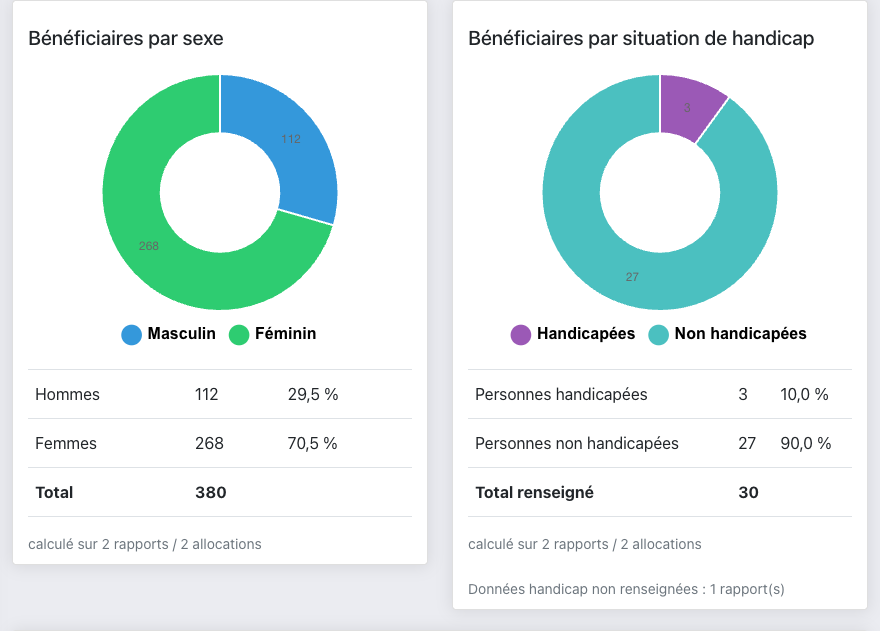
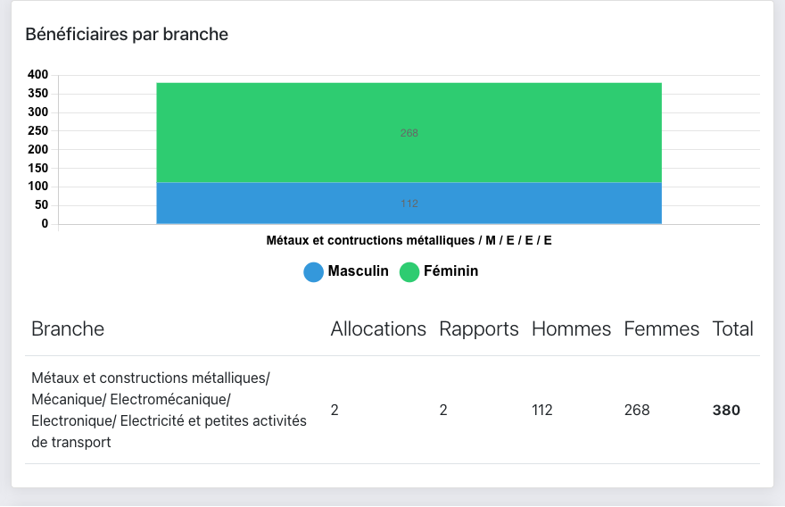

# Guide : bénéficiaires et rapports de fin d'allocation

Ce guide présente les quatre nouveautés demandées :

1. le point des bénéficiaires par secteur ou type d'activité ;
2. le taux de bénéficiaires par sexe ;
3. le taux de bénéficiaires par situation de handicap ;
4. un rapport au terme de chaque allocation.

Tout repose sur une seule saisie : **le rapport post-appui**. Les statistiques ne font que relire ce qui y a été déclaré. Un rapport non saisi, ou saisi à moitié, se voit directement dans les chiffres.

> Les captures de ce guide ont été prises sur une base de test. Les noms et les montants qu'on y voit ne sont pas réels.

## Qui peut faire quoi

| Action | Secrétaire | Vérificateur | Directeur |
|---|:---:|:---:|:---:|
| Saisir ou modifier un rapport post-appui | | ✔ | ✔ |
| Télécharger la fiche de fin d'allocation (PDF) | | ✔ | ✔ |
| Télécharger le rapport joint par la structure | | ✔ | ✔ |
| Consulter les indicateurs « Bénéficiaires » | | ✔ | ✔ |

## 1. Saisir le rapport de fin d'allocation

**Où :** menu **Post appui**. La liste contient toutes les demandes approuvées, c'est-à-dire celles dont le budget a été validé.

1. Sur la ligne de la structure, cliquez sur l'icône **Déposer/Éditer rapport**.
2. Remplissez la fenêtre :

| Champ | Obligatoire | À savoir |
|---|:---:|---|
| Date de dépôt du rapport | oui | Proposée à la date du jour |
| Nombre d'hommes formés | oui | |
| Nombre de femmes formées | oui | |
| Dont hommes handicapés | oui* | Ne peut pas dépasser le nombre d'hommes formés |
| Dont femmes handicapées | oui* | Ne peut pas dépasser le nombre de femmes formées |
| Observations | non | Texte libre, 5000 caractères au maximum |
| Rapport (PDF) | non | Fichier PDF uniquement, 10 Mo au maximum |

3. Cliquez sur **Enregistrer**. Pendant l'envoi du PDF, le bouton reste grisé : attendez qu'il redevienne actif avant de cliquer.

\* **Anciens rapports.** Les rapports saisis avant l'ajout du suivi du handicap n'ont pas cette information. Quand vous en rouvrez un, un message vous l'indique. Si vous ne connaissez pas le nombre de personnes handicapées, **laissez les deux champs vides** : n'inscrivez pas 0, ce qui fausserait le taux. Vous pouvez quand même corriger la date, ajouter des observations ou joindre le PDF. Si vous remplissez l'un des deux champs, l'autre devient obligatoire.

**Modifier un rapport.** Rouvrez-le avec la même icône. Si vous ne choisissez pas de nouveau fichier, le PDF déjà joint est conservé. Si vous en choisissez un, il remplace l'ancien.

Une fois le rapport enregistré, deux icônes apparaissent sur la ligne :

- **Fiche de fin d'allocation (PDF)** : génère la fiche décrite ci-dessous ;
- **Télécharger le rapport déposé** : visible seulement si un PDF a été joint.

## 2. La fiche de fin d'allocation

Il s'agit d'un PDF généré à la demande, à l'en-tête de la FDA. Il reprend :

- l'allocation : code, structure, branche, service, montant demandé, appui accordé, date d'approbation, date de dépôt du rapport ;
- les bénéficiaires formés : hommes, femmes et total, avec la ligne « dont personnes handicapées » (ou « Non renseigné » pour un ancien rapport) ;
- les observations.

Exemple : [fiche-allocation-119.pdf](verification/fiche-allocation-119.pdf).

## 3. Les indicateurs « Bénéficiaires »

**Où :** menu **Statistiques**, section **4. Bénéficiaires (rapports post-appui)**, en bas de la page. Elle est incluse dans l'impression (portrait ou paysage).

### Par sexe et par situation de handicap

- **Bénéficiaires par sexe** : nombre d'hommes et de femmes formés, avec leur part en %.
- **Bénéficiaires par situation de handicap** : personnes handicapées et non handicapées, avec leur part en %.
- Sous chaque carte, une ligne indique **sur quoi repose le taux** (voir « Lire la couverture » plus bas).

### Par secteur (branche) et par type d'activité (service)

Pour chaque branche, puis pour chaque service, un histogramme hommes/femmes et un tableau donnent :

| Colonne | Signification |
|---|---|
| Allocations | Demandes approuvées dans cette branche ou ce service |
| Rapports | Parmi elles, celles qui ont un rapport post-appui |
| Hommes / Femmes / Total | Personnes formées déclarées dans ces rapports |

« Branche inconnue » regroupe les demandes dont la branche a été supprimée de la liste des branches. « Non renseigné » regroupe celles qui n'ont pas de branche.

Ce tableau remplace l'ancien graphique « Effectifs par branche des dossiers approuvés ». Le graphique voisin s'appelle désormais « Nombre de dossiers approuvés par branche ».

## 4. Comment les chiffres sont calculés

### Définitions

- **Allocation** : une demande approuvée, c'est-à-dire dont le budget a été validé par un vérificateur.
- **Bénéficiaire** : une personne formée, déclarée dans le rapport post-appui. Ce n'est pas l'artisan ni la structure qui a déposé la demande.

### Règles

1. Seules les allocations **avec un rapport déposé** comptent dans les bénéficiaires.
2. On **additionne d'abord les effectifs** de tous les rapports, **puis** on calcule le taux. On ne fait jamais la moyenne des taux de chaque allocation : une formation de 300 personnes pèse 100 fois plus qu'une formation de 3.
3. Le **taux handicap** ne porte que sur les rapports où l'information a été saisie. Les anciens rapports sans cette donnée en sont exclus et comptés à part (« Données handicap non renseignées : N rapport(s) »).
4. Les taux sont arrondis à une décimale. Quand il n'y a rien à calculer (aucun rapport), la page affiche **n/d** au lieu de 0 %.
5. Seules les demandes **de l'exercice en cours** sont prises en compte. Les dossiers clôturés n'y figurent pas (voir « Limites »).

### Exemple

| Allocation | Hommes formés | Femmes formées | Dont handicapés |
|---|---:|---:|---|
| A | 12 | 18 | 2 H + 1 F |
| B (ancien rapport) | 100 | 250 | non renseigné |

- **Par sexe :** 112 hommes et 268 femmes, soit 380 personnes : **29,5 %** d'hommes (112 / 380) et **70,5 %** de femmes.
- **Handicap :** seul A est renseigné, donc 3 personnes handicapées sur 30 : **10,0 %**, avec la mention « 1 rapport non renseigné ».
- **Si l'on avait saisi 0 pour B,** on obtiendrait 3 / 380 = 0,8 %, un chiffre faux. C'est pour cela qu'il faut laisser vide quand l'information n'est pas connue.

### Lire la couverture

La ligne « calculé sur **N rapports / M allocations** » dit combien d'allocations ont réellement servi au calcul. Avec « 11 rapports / 29 allocations », le taux ne décrit que 11 allocations sur 29. Ce n'est pas un chiffre pour l'ensemble du fonds. Pour la fiabiliser, faites saisir les rapports manquants.

Le taux handicap a sa propre ligne : « Taux handicap calculé sur N rapport(s) renseigné(s) / M allocations ».

### Pourquoi les totaux diffèrent des sections 1 et 2

Les sections existantes comptent les dossiers d'après leur libellé « Approuvé ». La nouvelle section compte toutes les demandes dont le budget a été validé. Certains dossiers anciens sont approuvés mais n'ont pas ce libellé. Les deux totaux peuvent donc légèrement différer, et c'est voulu : la nouvelle section suit exactement la liste du menu **Post appui**.

## Bonnes pratiques

- **Saisissez les rapports avant de clôturer l'exercice.** La clôture déplace les demandes de l'année vers les dossiers clôturés. Après la clôture, leur rapport ne peut plus être saisi ni modifié depuis **Post appui**.
- **Renseignez toujours le nombre de personnes handicapées** dans les nouveaux rapports, même quand il est de 0.
- **Joignez le PDF du rapport** de la structure : il reste téléchargeable depuis la ligne de l'allocation.

## Limites actuelles

| Limite | Conséquence |
|---|---|
| Exercice en cours uniquement | Après une clôture, la section repart de zéro. Les données des rapports sont toutefois conservées dans les dossiers clôturés et pourront y être affichées plus tard. |
| Pas d'export Excel de ces indicateurs | Utilisez l'impression de la page statistiques. |
| Export Excel des dossiers clôturés | Il n'inclut pas encore les champs handicap ni les observations. |

## Questions fréquentes

**Le taux affiche « n/d ».** Aucun rapport utilisable n'a encore été saisi pour cet indicateur : il n'y a rien à calculer.

**Je ne trouve pas une structure dans Post appui.** La liste ne contient que les demandes approuvées (budget validé) de l'exercice en cours.

**L'enregistrement est refusé.** Lisez le message sous le champ en rouge. Les cas les plus fréquents :
- le nombre de personnes handicapées dépasse le nombre de personnes formées ;
- le fichier n'est pas un PDF ;
- le fichier dépasse 10 Mo ;
- un seul des deux champs handicap est rempli sur un ancien rapport.

**Le bouton « Enregistrer » est grisé.** Le PDF est en cours d'envoi : attendez la fin de l'envoi.
